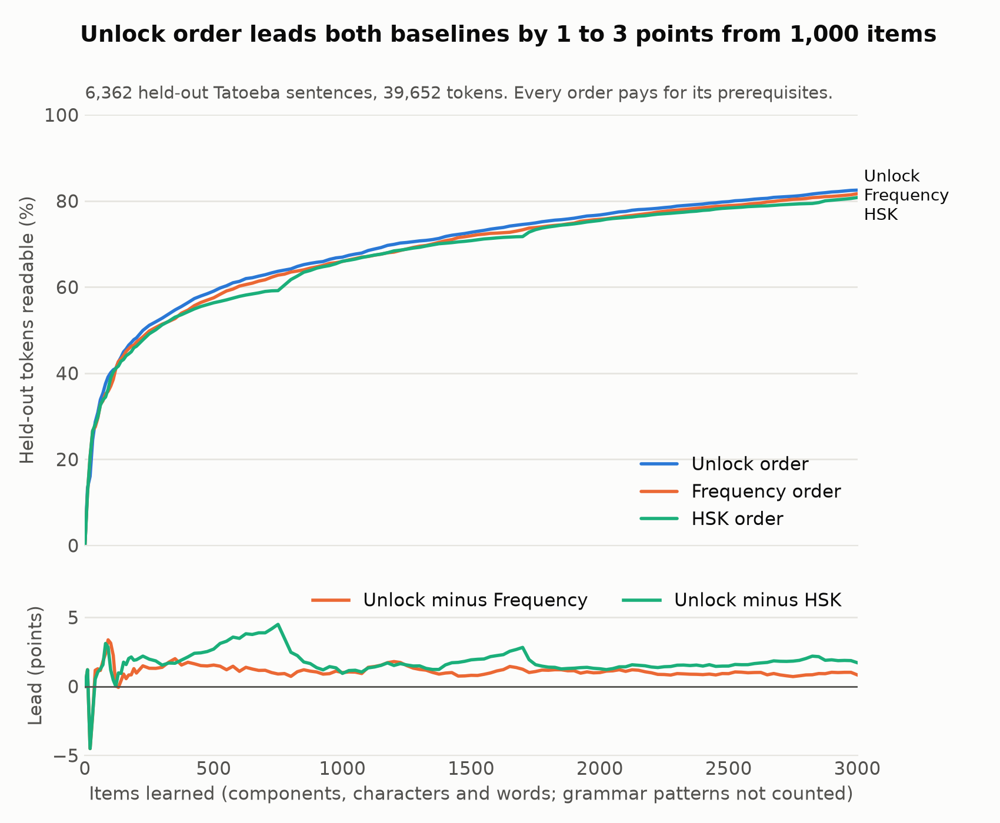

# Jiesuo 解锁

An open-source Mandarin learning tool built on a dependency graph of the language:
components → characters → words → grammar patterns → sentences.

Tokens readable after N items, every order paying for its prerequisites:

| Items learned | Tatoeba: Unlock | Tatoeba: HSK | Hong Kong: Unlock | Hong Kong: HSK | Wiki and news: Unlock | Wiki and news: HSK |
|---:|---:|---:|---:|---:|---:|---:|
| 100 | 40.1% | 38.9% | 32.1% | 30.0% | 29.0% | 24.9% |
| 500 | 58.8% | 56.2% | 53.7% | 44.7% | 45.1% | 32.0% |
| 1,000 | 66.7% | 65.7% | 64.5% | 58.8% | 55.5% | 43.2% |
| 2,000 | 75.9% | 74.7% | 77.8% | 69.6% | 68.3% | 56.4% |

- **Unlock against frequency:** unlock leads by about 1 to 4 points on Tatoeba and wiki/news. On
  Hong Kong text the lead disappears at 1,000 items.
- **Tatoeba is the odd one out:** HSK order is almost as good on its short learner sentences, and
  reads more whole sentences there. On the other two sets, unlock is far ahead and the
  whole-sentence advantage is gone.
- **Where the other two sets come from:** Hong Kong film subtitles and LegCo speech, and Wikipedia
  and news, all from Universal Dependencies treebanks never used for building or tuning.
- **A sentence-aware order (tried and rejected):** a variant that also rewards finishing whole
  sentences was tuned on training data and then failed its pre-registered test on Hong Kong text,
  so it is not used.

Confidence intervals and every comparison are in [reports/phase2_checkpoint.md](reports/phase2_checkpoint.md).
Accuracy checks on vocabulary, word splitting and grammar detection are in [reports/accuracy.md](reports/accuracy.md).

## Using the app

Open `app/index.html` through any static server (`python -m http.server -d app`), or publish
`app/` to GitHub Pages with the included workflow. After one visit it works offline, and on a
phone "Add to Home Screen" installs it with its own icon. There is no server and no account.

- **Today:** the home screen. A short daily lesson: meet a few new things and see each one put
  together from parts you know, hear it, write it stroke by stroke, review earlier ones, and finish
  on a real sentence you can now read in full. A journey path shows milestones reached and the next one.
  No streaks to lose: missed days are never mentioned. Once a week, **Your week** shows only what you
  gained (characters, words, sentences, how much more everyday text you can read); a quiet week passes silently.
- **Sound families:** most characters are a meaning part plus a sound part. A character page shows its
  family (清 晴 请 情 all take 青 qīng), marks which still sound the same, rhyme or have drifted, and shows
  each member's meaning part as a picture (💧 water, 💬 speech, ❤️ heart). Lessons mention the family of
  each new character, and which members you already know.
- **Say it:** on every word page and after a Read check, record yourself. Your pitch is drawn over each
  tone's shape, syllable by syllable, with the regular tone changes (你好 ní hǎo) taken into account. This
  runs on the device. **Check the words too** uses the browser's speech recognition, only when tapped,
  and says that the audio goes to the browser maker.
- **Reading wall:** every real Tatoeba sentence you can read in full, newest first, with audio.
- **Write it:** on every character page, watch the stroke order, trace it, or write from memory.
  Strokes you already know from a part are drawn in blue. Mistakes get a hint, never a penalty.
- **Search** (magnifier, or press `/`): one box for characters in either script, pinyin with or
  without tones (`nihao`, `ni3hao`, `nǐ hǎo`, `lv4`), or English. **✍ Write a character** to find one
  you can't type: draw it and pick it from the closest matches. **+ Add to my reviews** on a result
  or any word page puts it into your next lesson's reviews, like adding a flashcard; once today's lesson
  is done, Today offers a quick review round for them.
- **Next:** the next 10 things to learn and why each matters. Choose fastest reading or HSK focus.
- **Read:** paste Chinese text to see what you can read, and the smallest set of things to learn for the rest.
  Then guess what each sentence means in English: **Check my guess** marks every word you got in blue and
  every word you missed in amber, with its pinyin, meaning and picture under it, and a bar of how much you
  understood. Words you missed or don't know yet go into your reviews with one tap. The whole sentence in
  English comes from Tatoeba when it is one of ours, otherwise from your browser's own on-device translator
  (recent desktop Chrome) or, only when you tap it, Google Translate in a new tab. With a translation, each
  word shows the sense the sentence uses. **I meant that** accepts your own wording for a word from then on,
  and **Listen first** hides the text until you have guessed from the audio.
- **Map:** one item in the middle, what it is built from on the left, and what it unlocks on the
  right, each marked ready now or with what it still needs. Tap any square to move it to the middle.
  Starts on your next item; "See it on the map" on any word page opens it there. Below: everything
  ready to learn now, and the whole language as a grid.
- **Progress: what you've learned.** Every character, word, part and grammar pattern you know, to revisit:
  grouped by when you learned it, by meaning (characters gathered under 💧 氵 water, 👄 口 mouth…), by HSK
  level, or by what needs a refresh. Each tile shows a five-step memory bar from your reviews (amber when it
  is due again), and **Practise these** starts a review round of the ten least secure in any group. A find
  box filters by character, pinyin or English. Below: save your progress to a file and restore it, or
  **Send to my other device** through the phone's share sheet. There is still no account or server.
- **简/繁:** switch script anywhere. Learning one form counts toward the other.
- **Dictation every two weeks:** Today offers a dictation of up to 10 words from the fortnight. You hear
  each one (single characters as a teacher says them, 好，最好的好) and write it from memory; missed ones
  come back in your reviews. Without a Chinese voice on the device it shows the pinyin instead.
- **Pictures:** about 610 words (马, 学校, 苹果, 下雨, and actions such as 吃, 写, 听) have a picture beside
  their meaning, from OpenMoji, and reviews ask "which picture is it?" for them. 72 meaning parts (氵, 扌,
  讠…) have one too, shown wherever a part gives a character its meaning. Abstract words have none.
- **Audio:** a speaker button uses the device's own Mandarin voice, and is hidden when there is none.

## Rebuilding the data

    python -m venv .venv && . .venv/bin/activate
    pip install -r requirements.txt
    python scripts/fetch_data.py        # downloads data/raw, writes data/manifest.json
    python -m jiesuo.build_graph        # writes data/graph (about 20 seconds)
    python -m jiesuo.evaluate --tune    # picks settings on training sentences only
    python -m jiesuo.order              # writes data/order
    python -m jiesuo.evaluate           # scores held-out sentences
    python -m jiesuo.export_app         # writes app/data, one file per licence
    python -m jiesuo.glosses            # refreshes meanings alone (needs only data/raw/cedict.json)
    python -m jiesuo.export_strokes     # writes app/strokes and app/data/stroke-parts.json
    python -m jiesuo.export_pictures    # writes app/pictures and app/data/pictures.json
    python -m jiesuo.export_handwriting # writes app/data/handwriting.json (after export_strokes)
    python scripts/phase1_report.py && python scripts/phase2_report.py
    python scripts/segmentation_check.py      # word splitting against UD
    python scripts/grammar_audit.py score     # grammar detection, from the labelled sample
    pytest && node --test tests/app.test.js tests/tone.test.js tests/handwriting.test.js

## Licences

See [LICENSES.md](LICENSES.md). Each example sentence names its Tatoeba author and translator,
as CC BY 2.0 FR requires. To refresh the names alone: `python scripts/fetch_data.py && python -m jiesuo.tatoeba_credits`.

## Known limitations

- **Three test sets, all short.** Tatoeba, about 1,000 Hong Kong subtitle and LegCo sentences, and
  1,500 wiki and news sentences. Novels and social media are untested. The wiki and news set
  shares Wikipedia with our frequency source.
- **Equal cost.** A component, a character and a word all cost 1 item, which is not how hard they are.
- **Knowing a character means reading every use of it.** Senses are not modelled, so learning
  行 as xíng also counts for háng.
- **Traditional is free.** Knowing 学 counts as reading 學. The app marks these tokens and lets you
  confirm the other form per item, but the percentage still counts them.
- **Word splitting differs from the evaluation.** The app splits text its own way, not with jieba.
  On wiki and news text it splits names it doesn't know into single characters, which can make
  the Read percentage too high. Its accuracy is measured in reports/accuracy.md.
- **Script conversion in Read is per word.** Text typed in Traditional is shown as typed. When
  Simplified text is converted, a lone character with more than one Traditional form (发) gets a "?".
- **Grammar does not affect the percentage.** Read can only spot the 67 patterns made of fixed
  words. Detection is about 92% precise, and finds about 65% of real uses. Pattern HSK levels are
  the author's estimates.
- **The HSK word list is OCR** and not fully proofread.
- **The tone check is a guide.** It tracks pitch and compares each syllable's shape with the four tones.
  It is tested on synthetic voices only, splits syllables by pauses and length (so fast, joined-up speech
  can be split wrongly), and noise, a cold or a whisper confuse it. Neutral tones are not scored.
- **Handwriting search** compares stroke start, middle and end points with the 3,500 characters the app
  teaches. Very messy writing, or a character outside that set, will not be found.
- **Guess checking matches words, not sense.** A guess counts a word as understood when it shares a
  word with any of its dictionary meanings (after simple stemming), so a guess with the right words in
  the wrong order scores well, and a correct paraphrase can miss ("earn" for 赚 "to make a profit").
  Grammar words such as 的, 了 and 是 are not scored. The meaning shown under a missed character is its
  first sense, which is not always the one the sentence uses (带 shows "band", not "to bring").
