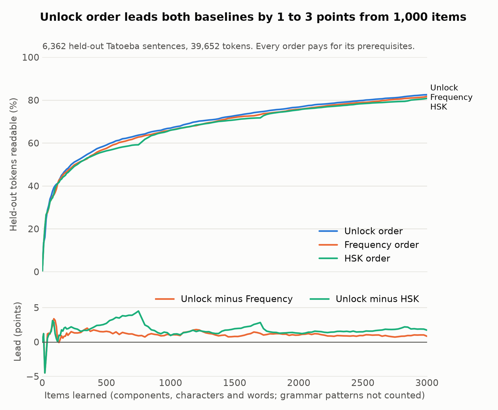

# Phase 2 checkpoint

Held-out: 6,362 sentences, 39,652 Han tokens, of which 35,610 are graph words, 3,978 are readable only by splitting into smaller units, and 64 use a character outside the graph. Lookahead weight, chosen on training sentences: 0.0.

## Primary: a component is required only when the data explains why it is there

| Items | Unlock | Frequency | HSK | Lead over frequency (95% CI) | Lead over HSK (95% CI) |
|---:|---:|---:|---:|---:|---:|
| 100 | 40.1% | 37.0% | 38.9% | +2.9 to +3.4 | +0.9 to +1.5 |
| 500 | 59.1% | 57.5% | 56.4% | +1.3 to +1.8 | +2.3 to +3.1 |
| 1,000 | 67.0% | 66.0% | 66.0% | +0.8 to +1.2 | +0.6 to +1.3 |
| 2,000 | 76.8% | 75.8% | 75.5% | +0.8 to +1.2 | +0.9 to +1.7 |

## Sensitivity: every component edge required

| Items | Unlock | Frequency | HSK | Lead over frequency (95% CI) | Lead over HSK (95% CI) |
|---:|---:|---:|---:|---:|---:|
| 100 | 37.7% | 35.4% | 35.4% | +2.0 to +2.6 | +2.0 to +2.6 |
| 500 | 58.2% | 57.0% | 56.0% | +1.1 to +1.5 | +1.8 to +2.6 |
| 1,000 | 66.7% | 65.7% | 65.4% | +0.8 to +1.2 | +1.0 to +1.7 |
| 2,000 | 76.6% | 75.7% | 75.4% | +0.7 to +1.1 | +0.8 to +1.6 |

## Sensitivity: no component required

| Items | Unlock | Frequency | HSK | Lead over frequency (95% CI) | Lead over HSK (95% CI) |
|---:|---:|---:|---:|---:|---:|
| 100 | 46.1% | 45.1% | 44.9% | +0.7 to +1.1 | +0.8 to +1.4 |
| 500 | 61.9% | 60.6% | 57.8% | +1.1 to +1.6 | +3.7 to +4.6 |
| 1,000 | 69.0% | 67.8% | 68.0% | +1.0 to +1.4 | +0.6 to +1.4 |
| 2,000 | 78.1% | 77.1% | 76.7% | +0.7 to +1.1 | +1.0 to +1.7 |

## Whole sentences readable (primary mode)

| Items | Unlock | Frequency | HSK | HSK minus unlock (95% CI) |
|---:|---:|---:|---:|---:|
| 100 | 0.3% | 0.2% | 0.3% | -0.1 to +0.1 |
| 500 | 3.8% | 3.4% | 4.7% | +0.3 to +1.5 |
| 1,000 | 8.7% | 8.2% | 11.5% | +2.0 to +3.5 |
| 2,000 | 20.4% | 19.3% | 22.1% | +0.7 to +2.8 |

## HSK focus, the app's alternative order (primary mode)

| Items | Tokens readable | Whole sentences readable |
|---:|---:|---:|
| 100 | 39.7% | 0.3% |
| 500 | 56.4% | 5.0% |
| 1,000 | 66.2% | 11.6% |
| 2,000 | 75.6% | 22.3% |

## Counting only tokens that are graph words (no splitting)

| Items | Unlock | Frequency | HSK |
|---:|---:|---:|---:|
| 100 | 39.8% | 36.8% | 38.5% |
| 500 | 57.1% | 56.1% | 54.4% |
| 1,000 | 63.9% | 63.3% | 63.0% |
| 2,000 | 72.1% | 71.5% | 70.9% |

## SUBTLEX-CH subtitle tokens (not held out: wordfreq includes SUBTLEX)

| Items | Unlock | Frequency | HSK |
|---:|---:|---:|---:|
| 100 | 44.1% | 41.2% | 43.3% |
| 500 | 65.9% | 63.9% | 61.7% |
| 1,000 | 73.6% | 72.5% | 71.4% |
| 2,000 | 82.0% | 81.1% | 79.5% |

汤姆 and 玛丽 alone are 1.5% of held-out tokens.
